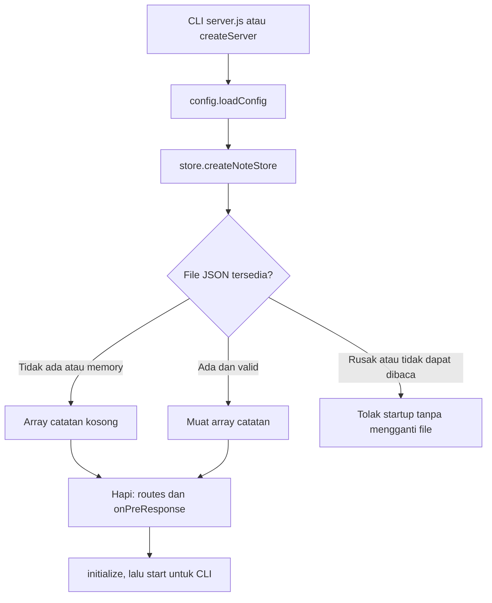
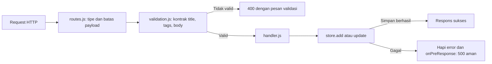
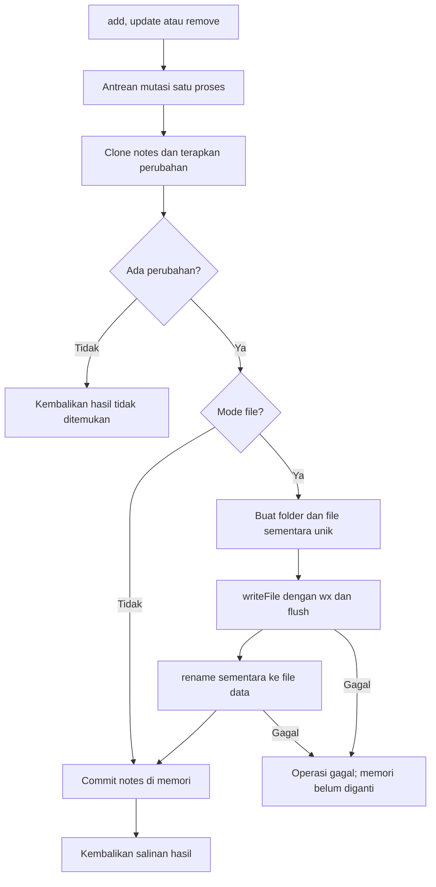

# Alur Notes App Back End

## Startup dan konfigurasi

[src/server.js](../src/server.js) menyediakan factory createServer dan entry CLI. CLI memanggil createServer, memulai Hapi dan memasang handler SIGINT/SIGTERM untuk penghentian server. Factory dapat diimpor pengujian tanpa membuka listener HTTP.

[src/config.js](../src/config.js) membaca dan memvalidasi PORT, HOST, DATA_FILE serta CORS_ORIGINS dari environment. File data relatif dihitung dari root proyek; nilai `:memory:` menjadi null untuk store sementara. Default mengikat 127.0.0.1:5000 dan menyimpan data/notes.json. Factory membuat store terlebih dahulu, mendaftarkan rute/penanganan error, lalu initialize server.

## Request ke handler

[src/routes.js](../src/routes.js) mendefinisikan endpoint berikut; seluruhnya mengembalikan JSON, bukan halaman HTML.

| Method/path | Handler dan hasil |
| --- | --- |
| GET /health | Status proses sederhana |
| POST /notes | addNoteHandler, simpan catatan lalu 201 dengan noteId |
| GET /notes | getAllNotesHandler, salinan seluruh catatan |
| GET /notes/{id} | getNoteByIdHandler, detail atau 404 |
| PUT /notes/{id} | editNoteByIdHandler, ganti title/tags/body atau 404 |
| DELETE /notes/{id} | deleteNoteByIdHandler, hapus atau 404 |

POST/PUT memakai application/json dan batas 128 KiB. [src/validation.js](../src/validation.js) mensyaratkan tepat title, tags dan body: title tidak kosong maksimal 200 unit karakter JavaScript, body maksimal 100000, tags maksimal 20 string yang masing-masing maksimal 50 unit. Tidak ada field tambahan; PUT bukan patch sebagian.

[src/handler.js](../src/handler.js) mempertahankan format status/message/data. Detail/update/delete ID yang tidak ada mendapat 404. onPreResponse di server.js mengubah Boom error menjadi respons yang konsisten untuk JSON rusak, rute hilang, payload terlalu besar atau tipe konten salah; 500 tidak mengirim detail path/exception penyimpanan.

## Mutasi dan persistensi

[src/store.js](../src/store.js) memiliki state notes dan satu antrean Promise. add/update/remove membuat operasi pada antrean itu agar mutasi yang berdekatan dalam satu proses tidak menimpa hasil sebelumnya. Input disalin sebelum digunakan; list/find/hasil mutasi juga berupa salinan, sehingga pemanggil tidak mengubah state lewat referensi objek.

Catatan baru mendapat ID acak 16 karakter base64url dan createdAt/updatedAt ISO UTC. Update mempertahankan ID/createdAt; updatedAt tidak lebih tua dari nilai sebelumnya. Delete menghapus satu catatan berdasarkan ID. File sementara dibersihkan pada finally; kegagalan operasi tidak memutus antrean untuk request berikutnya.

Saat startup, array tersimpan diperiksa ulang: kontrak field, ID unik, jumlah field dan timestamp harus valid. File rusak tidak otomatis direset. Persistensi ini hanya mengoordinasikan satu proses; tidak ada lock lintas proses, database atau jaminan pemulihan untuk seluruh kegagalan daya. Gunakan satu proses per file.

## Batas layanan dan berkas pendukung

Tidak ada login, kepemilikan per pengguna atau otorisasi. CORS mengatur akses browser lintas origin dan bukan autentikasi. GET /notes memberi seluruh koleksi bersama. Penjelasan konfigurasi/cadangan ada di [README](../README.md), sedangkan contoh request tersedia di [docs/postman](postman/README.md).

[compose.yaml](../compose.yaml) memasang volume notes-data di /app/data, menetapkan file JSON serta mengikat port host lokal. [Dockerfile](../Dockerfile) memasukkan dependensi produksi dan src/, bukan halaman frontend. Dokumentasi ini tidak membuat endpoint /books atau memadukan aplikasi Bookshelf terpisah.

[test/api.test.js](../test/api.test.js), [test/store.test.js](../test/store.test.js) dan [test/config.test.js](../test/config.test.js) menyediakan pemeriksaan request, persistensi dan konfigurasi. Penambahan dokumen ini didasarkan pada pembacaan sumber; tidak ada tes/runtime yang dijalankan ulang dan tidak ada kode yang diubah.
